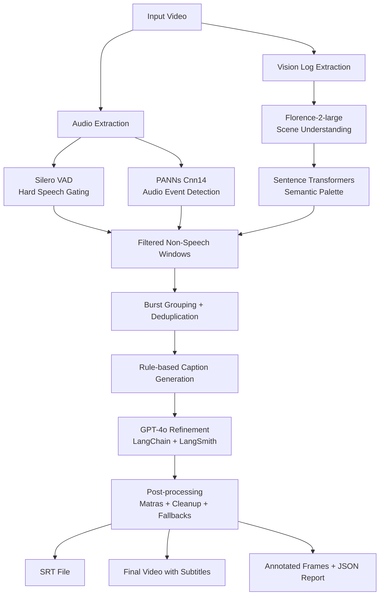

# Intelligent Closed Caption Suggestion Tool

**PlanetRead – C4GT 2026 DMP**  
**Contributor:** Aditi Prabakaran

---

## Overview

This project generates **high-quality Hindi closed captions** for non-speech audio events in Indian video content such as TV dramas, educational videos, and documentaries.

Traditional subtitle systems primarily focus on speech transcription. This pipeline is designed specifically for **non-dialog audio events**, including:

- Music and traditional instruments (tabla, sitar, dhol, shehnai)
- Laughter
- Bird calls and environmental sounds
- Footsteps, rustling, wind, and other ambient sounds

The system produces clean, professional Hindi captions in the format **`[caption text]`** and burns them directly onto the final video using the **Tiro Devanagari** font.

---

## Running the App Locally

This starts the full web app: a FastAPI backend that runs the captioning pipeline, and a Vite frontend where you upload a video, watch progress, review the captions and download the results.

### Requirements

- Python **3.10 to 3.12** (3.10 is what the project is tested with; 3.13 is not supported by the pinned packages)
- Node.js **18 or newer** (20 recommended)
- Git
- An **OpenAI API key** (only caption writing calls OpenAI)
- About 10 GB of free disk space. The first run downloads the model weights (Florence-2, PANNs, MiniLM) and needs internet.
- A GPU (NVIDIA CUDA or Apple Silicon) is optional but strongly recommended. On CPU a full episode takes much longer.

ffmpeg does not need to be installed separately; the pipeline falls back to the copy bundled with `imageio-ffmpeg`.

### 1. Clone the repository (with the Music2Emotion submodule)

```bash
git clone --recursive https://github.com/Aditi2k5/Intelligent-cc-generation.git
cd Intelligent-cc-generation
```

If you already cloned without `--recursive`, run `git submodule update --init`.

### 2. Set up the Python environment and install dependencies

macOS / Linux:

```bash
python3 -m venv .venv
source .venv/bin/activate
pip install --upgrade pip
pip install -r requirements.txt
pip install -r backend/requirements.txt
```

Windows (PowerShell):

```powershell
py -3.10 -m venv .venv
.venv\Scripts\Activate.ps1
python -m pip install --upgrade pip
pip install -r requirements.txt
pip install -r backend/requirements.txt
```

Install only the top-level `requirements.txt`. Do **not** run `pip install -r Music2Emotion/requirements.txt`, because its pinned versions conflict with the project's.

### 3. Add your OpenAI API key

Pick either option:

- Create a file named `.env` in the repository root containing:
  ```
  OPENAI_API_KEY=sk-your-key-here
  ```
- Or skip this step and paste the key into the **Settings** dialog in the web app the first time you open it.

A key saved in Settings takes priority over the `.env` value.

### 4. Start the backend (terminal 1)

From the repository root, with the virtual environment active:

```bash
uvicorn backend.app:app --host 127.0.0.1 --port 8000
```

Check it at <http://127.0.0.1:8000/api/health>. It should return `{"status":"ok", ...}`.

### 5. Start the frontend (terminal 2)

```bash
cd frontend
npm install
npm run dev
```

Open <http://127.0.0.1:5173>. The dev server forwards all `/api` requests to the backend on port 8000. If your backend runs elsewhere, set `PLANETREAD_API_URL` before `npm run dev`.

### 6. Use it

1. Upload an `.mp4`, `.mov`, `.webm` or `.mkv` video.
2. Click process and wait. The first job is slow because the models load for the first time.
3. Review the result. Captions the model was unsure about appear as blanks; fill them in, then click **Save all & finalize**. Blanks you leave empty are dropped from the final SRT.
4. Download `captions.srt` and the captioned video.

Jobs and outputs are stored in `backend_data/jobs/<job-id>/output/` (`captions.srt`, `final_output.mp4`, `results.json`, `annotated_frames/`).

### Troubleshooting

| Problem | Fix |
|---|---|
| `ModuleNotFoundError: panns_pipeline` | Run `uvicorn` from the repository root, not from inside `backend/`. |
| Upload works but every request in the browser fails | The backend is not running on port 8000, or the frontend was not started with `npm run dev`. |
| Music mood falls back to scene text only | The `Music2Emotion` submodule is empty. Run `git submodule update --init`. |
| Very slow processing | You are on CPU. Use a machine with a CUDA or Apple Silicon GPU. |
| Models fail to download | Check your internet connection. Set `HF_TOKEN` in `.env` if Hugging Face rate-limits you. |
| Port already in use | Pass another port, e.g. `--port 8001`, and start the frontend with `PLANETREAD_API_URL=http://127.0.0.1:8001 npm run dev`. |

### Windows executable (no setup)

To run without installing Python or Node, build or download the packaged app; see [BUILD_DISTRIBUTION.md](BUILD_DISTRIBUTION.md).

---

## Current Status (October 2026)

The pipeline, review interface and local application are complete and working end to end.

| Component | Status | Notes |
|-----------|--------|-------|
| Music + Instrument Detection | Complete | Correctly detects tabla, sitar, dhol with natural phrasing |
| Music Mood (Music2Emo) | Complete | Valence/arousal from the real audio maps to Hindi mood captions |
| Universal Dictionary Mapping | Complete | Captions are mapped to the PlanetRead SLC Hindi dictionary for uniform wording; GPT-4o is now a minimal fallback |
| Laughter, Birds & Environmental Sounds | Complete | Natural and varied captions |
| Animal / Phone Misfire Control | Complete | Corroboration checks for animal and phone sounds, watermark text ignored |
| Silence-Gap Captions | Complete | A short caption where there is no speech for 3 seconds or more and nothing else is captioned |
| Mantra Continuity | Complete | Chanting is no longer broken up or relabelled as music mood |
| Hindi Matras & Formatting | Stable | Correct Devanagari, square brackets, no punctuation |
| Speech Overlap Prevention | Complete | Hard gating using Silero VAD |
| Confidence Handling & Review UI | Complete | Uncertain captions are left blank in the SRT; the user fills only those blanks and finalizes |
| Web App (FastAPI + Vite) | Complete | Upload, progress, results, caption review and downloads |
| Local Application | Complete | Runs on a local machine, including a packaged Windows executable |
| Video Rendering | Complete | Tiro Devanagari with clean subtitle overlay |
| Observability | Integrated | LangSmith for token usage and cost tracking |

### Tested On

- Bharat Ek Khoj episodes (including Episode 016)
- Circus episodes
- Strong performance on music, instruments, birds, and laughter, and far fewer false animal and phone captions than earlier versions

### Next Steps

- Multilingual testing beyond Hindi
- Evaluating lighter or paid vision models in place of Florence-2

---

## Architecture



---

## Key Components

| Stage | Technology | Role |
|-------|------------|------|
| Audio Event Detection | PANNs (Cnn14) | Detects non-speech sounds with per-class thresholds |
| Speech Gating | Silero VAD | Hard exclusion of speech segments |
| Scene Understanding | Florence-2-large | Generates detailed scene captions |
| Semantic Boosting | Sentence Transformers | Creates scene-aware sound palette |
| Caption Generation | Rule-based + GPT-4o | Produces natural, short Hindi captions |
| Tracking | LangSmith | Token usage and cost monitoring |
| Rendering | OpenCV + PIL + Tiro Devanagari | Professional subtitle overlay |

---

## Pipeline Flow

1. Extract audio and generate a vision log using Florence-2.
2. Run Silero VAD to create a hard speech mask.
3. Run PANNs on non-speech windows with class-specific thresholds.
4. Apply scene-aware semantic boosting.
5. Group nearby events into bursts.
6. Generate captions using deterministic rules followed by GPT-4o refinement.
7. Apply post-processing (matra fixes, animal filtering, and varied fallbacks).
8. Export the SRT file and render the final video with burned-in captions.

---

## Key Improvements Made

- Strict filtering of weak animal labels (duck, rodents, generic "animal")
- Explicit rules for correct Hindi matras (especially **घंटी** and **कौआ**)
- Varied natural ambient fallbacks instead of repetitive **"पर्यावरण की आवाज़"**
- Consistent music and instrument phrasing
- Full LangSmith integration for observability
- Professional video rendering using the Tiro Devanagari font

---

## Output Artifacts

- `captions.srt` — Final Hindi subtitle file
- `final_output.mp4` — Video with burned-in captions
- `results.json` — Full timeline and metadata
- `annotated_frames/` — Sample captioned frames
---

## Tech Stack

### Audio
- PANNs (Cnn14)
- Silero VAD
- torchaudio
- soundfile

### Vision
- Florence-2-large
- OpenCV
- Pillow (PIL)

### Language
- GPT-4o
- LangChain
- LangSmith

### Utilities
- Sentence Transformers
- NumPy
- FFmpeg

### Rendering
- OpenCV
- Pillow (PIL)
- Tiro Devanagari Font
